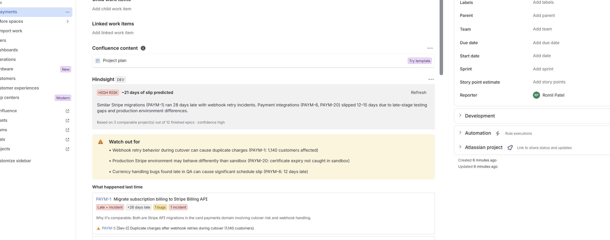

# Hindsight

**Pre-mortems built from your organisation's own history.**

> Jira finds similar tickets. Hindsight tells you **what happened** to them, and what to do differently.

When a team creates a new Epic, Hindsight finds the most similar *finished* work in the organisation, measures what
actually happened to it (schedule slip, bugs, incidents, retro notes), and posts an evidence-based forecast:

- 🔴 **Risk level and predicted slip** come from real outcome data. The model never makes up the numbers.
- 📚 **What happened last time**: up to 3 comparable past projects, each with a verdict and links to its incidents.
- ✅ **Lessons → tasks**: one click turns the lessons from past retros into Jira tasks under the new epic.
- 🧑‍🤝‍🧑 **People who've done this before**: owners of similar work and the people who fixed its incidents (with Teamwork Graph teams).
- 🎯 **Learning loop**: when the epic is done, Hindsight scores its own forecast and shows its accuracy.



More in [docs/SCREENSHOTS.md](docs/SCREENSHOTS.md).

Category: **Apps for Software Teams**. Built with **Rovo agents**, **Atlassian MCP** and the **Teamwork Graph**.

## For judges: try it in 5 minutes

No build and no credentials needed: Hindsight runs on Atlassian (Forge, production environment).

1. **Install** with the installation link in [`docs/INSTALL-LINK.txt`](docs/INSTALL-LINK.txt) (also in the Devpost submission) on a Jira site where you're an admin.
2. Open any Jira **software** space → **Hindsight** tab → **Load sample history** (about 1 minute; creates 12 finished sample epics with incidents and retro comments, clearly labelled as fictional "Northwind Pay" data).
3. Create an **Epic** named `Move checkout card payments to Stripe Payment Intents`.
4. Within about 20 seconds Hindsight comments on the epic with a pre-mortem. Open the full forecast with the **Apps (⬡) button under the title → Hindsight**.
5. Click **Add 5 lessons as tasks** → refresh, and the tasks appear under **Child work items**.
6. **Rovo** (sites with Rovo): Ask Rovo → agent picker → **Hindsight** → "What went wrong last time we touched payments?"
7. **MCP:** admin.atlassian.com → Apps → Sites → your site → Connected apps → Hindsight → View app details → **Tools → Enable tools**. Endpoint: `https://mcp.atlassian.com/forge/c01bdc09-a28c-4c76-9751-a77dd264f422`
8. **Teamwork Graph (optional):** same app page → Connections → Teamwork Graph connectors → **Hindsight → Connect**.

When you're done, **Remove sample data** on the Hindsight tab deletes everything it created. Screenshots: [`docs/submission-screenshots/`](docs/submission-screenshots/).

---

## Where it runs

| Surface | Module | What it does |
|---|---|---|
| Jira issue panel | `jira:issuePanel` | The full forecast, evidence cards, "Add lessons as tasks" and experts |
| Jira project page | `jira:projectPage` | Org memory stats, "What would history say about…?", recent pre-mortems, accuracy and the sample history loader |
| Automatic | `trigger` on `avi:jira:created:issue` | A new Epic gets a pre-mortem and a short comment within seconds |
| Learning loop | `trigger` on `avi:jira:updated:issue` | Epic moves to Done → prediction is scored against reality |
| Rovo | `rovo:agent`, `rovo:skill`, `action` ×4 | Chat agent "Hindsight", plus a reusable `hindsight-premortem` skill and actions any agent can call |
| MCP | `rovo:mcp` | `find-similar-work`, `get-forecast` and `get-experts` for Claude, Cursor, Codex … |
| Teamwork Graph (read) | `requestTeamworkGraph` | Adds each expert's Atlassian teams (persisted Cypher query) |
| Teamwork Graph (write) | `graph:connector` + `setObjects` | Each forecast is published to the graph as a document associated with the epic and the past work it cites |
| AI | `llm` (Forge LLMs, Claude) | Re-ranks candidates, writes the headline and lessons. Everything has a deterministic fallback. |

## How the forecast is built

1. **Memory**: every finished Epic on the site (`issuetype = Epic AND statusCategory = Done`), with comments and the `hindsight-history` property.
2. **Candidates**: TF-IDF cosine similarity with domain concepts (so *Stripe* work also matches *PayPal* or *billing* work), keeping the top 8.
3. **Outcomes**: one JQL call loads the children of all 8 candidates. For each candidate it measures planned vs actual days, slip, bugs, incidents (type, label or property) and who fixed them, and pulls retro sentences from comments.
4. **AI judgement** (Forge LLMs): the model picks the genuinely comparable projects, writes the headline and lessons, and must cite issue keys. Any keys it invents are dropped.
5. **Risk score**: weighted by similarity and computed **in code**: predicted slip, incident rate and late rate → HIGH / MEDIUM / LOW, plus a confidence level.
6. **Store**: the forecast is cached in Forge KVS and published to the Teamwork Graph.

If the LLM is unavailable, Hindsight still produces a full forecast from the data alone, and the UI says so.

---

## Setup

Requirements: **Node.js 22 or 24** (Forge CLI 14+ warns on Node 20), a free Atlassian developer site with Jira and Rovo.

```bash
npm install
npx forge login            # use an Atlassian API token: https://id.atlassian.com/manage/api-tokens
npx forge register         # writes your real app.id into manifest.yml
npx forge deploy
npx forge install --site <your-site>.atlassian.net --product jira
```

Then:

1. Open any Jira **software** project → sidebar → **Hindsight** → **Load sample history** (12 finished epics from the fictional "Northwind Pay", about 1 minute).
2. Create an Epic: *"Migrate card payments to Stripe Payment Intents API"*.
3. Within a few seconds you get a comment, and the **Hindsight** panel on the epic shows the full pre-mortem.

### Enable MCP (bonus)
Atlassian Administration → Apps → Sites → *your site* → Connected apps → **Hindsight** → turn on the tools under external access.
MCP endpoint: `https://mcp.atlassian.com/forge/<appId>`. `<appId>` is the UUID after `ari:cloud:ecosystem::app/` in `manifest.yml`.
Add it to Claude Desktop or Claude Code, Cursor or Codex, and ask: *"Before I start: what does Hindsight say about migrating payments to Stripe?"*

### Teamwork Graph (bonus)
- **Write**: Atlassian Administration → Connected apps → Hindsight → **Connections** → add a connection. From then on, every forecast is published to the graph.
  Before `forge deploy`, replace the two `REPLACE_ME` icon URLs in `manifest.yml` with a public URL for `static/icons/hindsight.svg` (for example your GitHub repo).
- **Read**: register this persisted Cypher query in the [TWG Query Builder](https://teamwork-graph.atlassian.com/query-builder):
  ```cypher
  MATCH (user:AtlassianUser {ari: $id})-[:atlassian_user_is_in_atlassian_team]->(team:AtlassianTeam)
  RETURN collect(distinct team) as teams
  ```
  then `npx forge variables set HINDSIGHT_TWG_TEAMS_QUERY <queryKey>` and `npx forge deploy`.
  The project page shows live status for both.

### Optional
- `npx forge variables set HINDSIGHT_MODEL <model-id>` pins a model. By default Hindsight picks the first active Claude Sonnet, then Haiku, then Opus from `@forge/llm` `list()`.

---

## Tests

```bash
npm test
```

There are 19 tests. **End-to-end tests run the real backend against an in-memory Jira** (`test/stubs/`): they load the sample history, create a new epic, run the automatic pre-mortem, add lessons as tasks, publish to TWG, run the learning loop, and check cold start and cleanup. They also cover the LLM path, including that hallucinated issue keys get dropped.

## Project layout

```
manifest.yml                 all modules: panel, project page, triggers, Rovo agent/skill/actions, MCP, LLM, TWG connector
src/index.js                 resolvers, Rovo/MCP action handlers, triggers
src/lib/core.js              pure logic: similarity, outcomes, risk model, experts (unit tested)
src/lib/forecast.js          the pre-mortem pipeline
src/lib/graph.js             Teamwork Graph read + write
src/lib/llm.js               Forge LLMs with model auto-selection and JSON parsing
src/lib/learn.js             forecast vs reality scoring
src/lib/seed.js              sample history loader ("Northwind Pay")
src/frontend/panel.jsx       issue panel (UI Kit)
src/frontend/home.jsx        project page (UI Kit)
prompts/agent-prompt.txt     Rovo agent prompt
skills/hindsight-premortem/  reusable Rovo skill
docs/                        demo script and Devpost submission text
```
