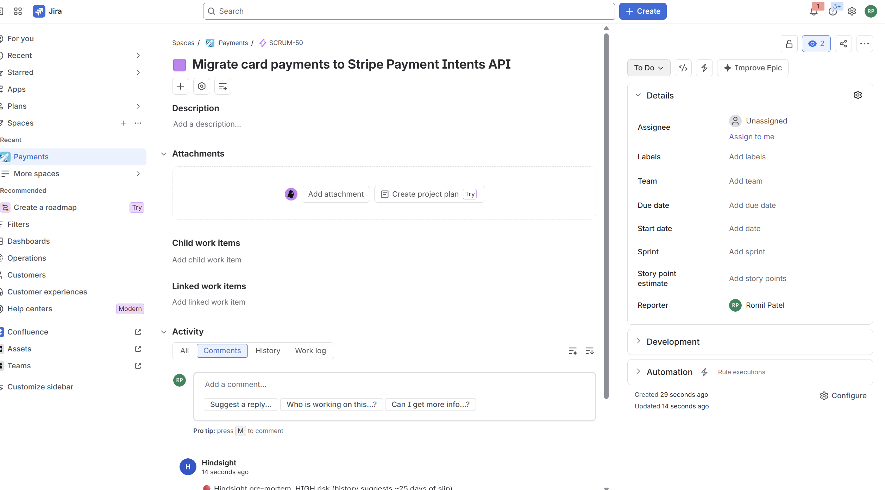
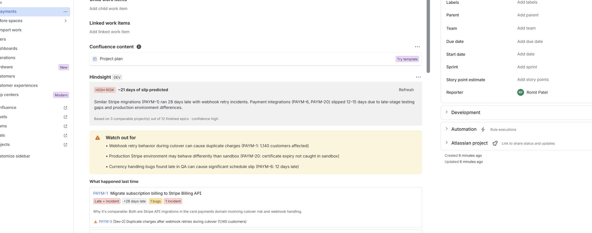
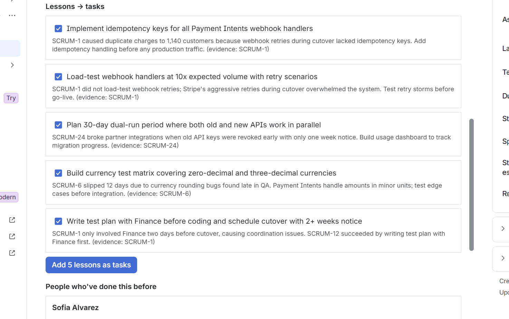
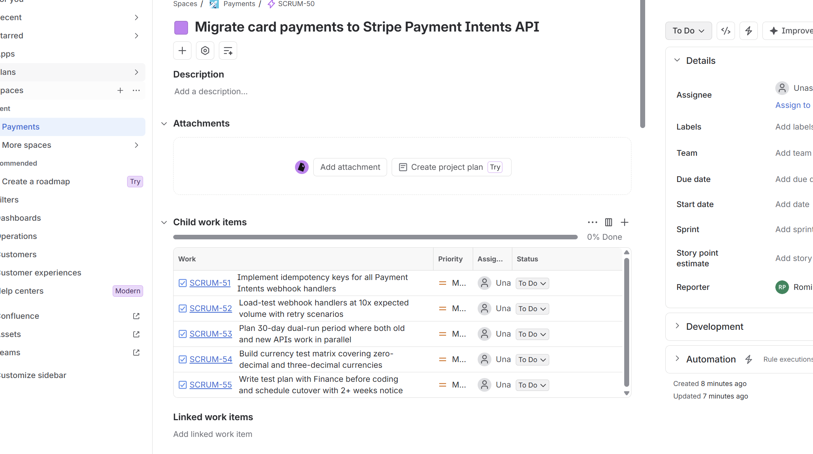
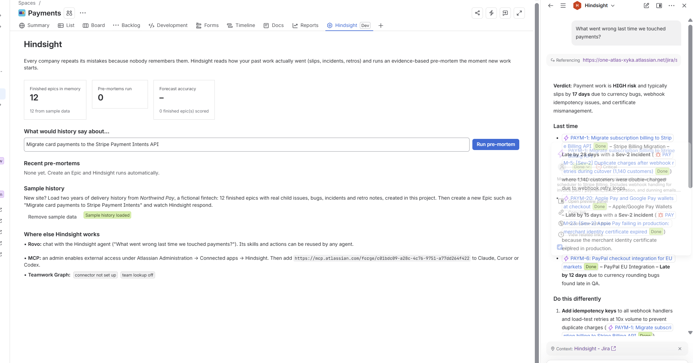
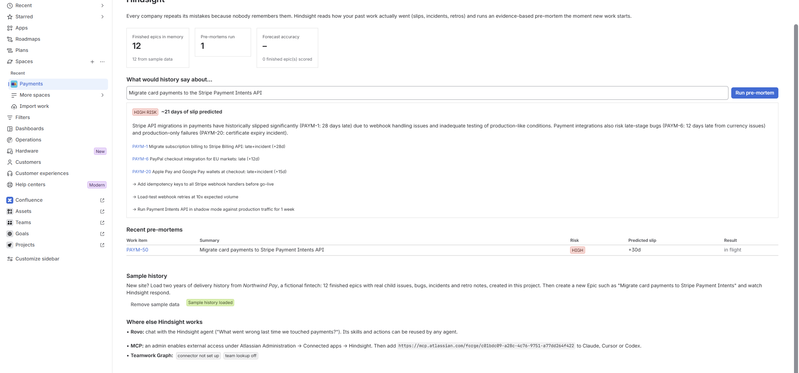

# Screenshots

Captured while building and testing Hindsight on real Atlassian Cloud sites (Nov 17–18, 2026).

## Highlights
| | |
|---|---|
| **Automatic pre-mortem on a new epic**  | **Issue panel forecast (after domain fix)**  |
| **Lessons → tasks, one click**  | **Tasks created under the epic**  |
| **Hindsight Rovo agent**  | **"What would history say about…" on the project page**  |

## Full timeline
1. Setup: [Atlassian home](screenshots/01-atlassian-home.png) · [developer site sign-up](screenshots/02-developer-site-signup.png) · [Jira space](screenshots/03-jira-scrum-space.png) · [Payments space](screenshots/04-payments-space.png)
2. Install: [Hindsight tab appears](screenshots/05-hindsight-tab-installed.png) · [empty project page](screenshots/06-hindsight-page-empty.png) · [create dialog](screenshots/07-create-dialog.png)
3. Sample history and first forecast: [history loaded](screenshots/08-sample-history-loaded.png) · [automatic comment](screenshots/09-auto-premortem-comment.png) · [recent pre-mortems](screenshots/10-recent-premortems.png) · [watchers](screenshots/11-epic-watchers.png) · [panel](screenshots/12-issue-panel-forecast.png)
4. Lessons → tasks: [lessons](screenshots/13-lessons-to-tasks.png) · [child tasks created](screenshots/14-lessons-created-as-child-tasks.png)
5. Rovo: [free dev site has no Rovo chat](screenshots/15-dev-site-no-rovo.png) · [Forge demo site](screenshots/16-demo-site-welcome.png) · [new Payments space](screenshots/17-create-payments-space.png) · [Ask Rovo available](screenshots/18-demo-site-ask-rovo.png)
6. Rovo answers: general Rovo [1](screenshots/19-rovo-general-answer-1.png) [2](screenshots/20-rovo-general-answer-2.png) [3](screenshots/21-rovo-general-answer-3.png) · **Hindsight agent** [1](screenshots/22-hindsight-agent-answer-1.png) [2](screenshots/23-hindsight-agent-answer-2.png) [3](screenshots/24-hindsight-agent-answer-3.png)
7. Domain-matching fix: [comment citing an unrelated OAuth2 project](screenshots/25-auto-comment-demo-site.png) · [dashboard before](screenshots/26-dashboard-before-fix.png) · [run pre-mortem after fix](screenshots/27-run-premortem-after-fix.png) · [recent pre-mortems](screenshots/28-recent-premortems.png) · [panel before refresh](screenshots/29-panel-before-refresh.png) · [panel after fix](screenshots/30-panel-after-domain-fix.png)
